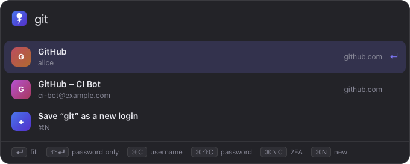
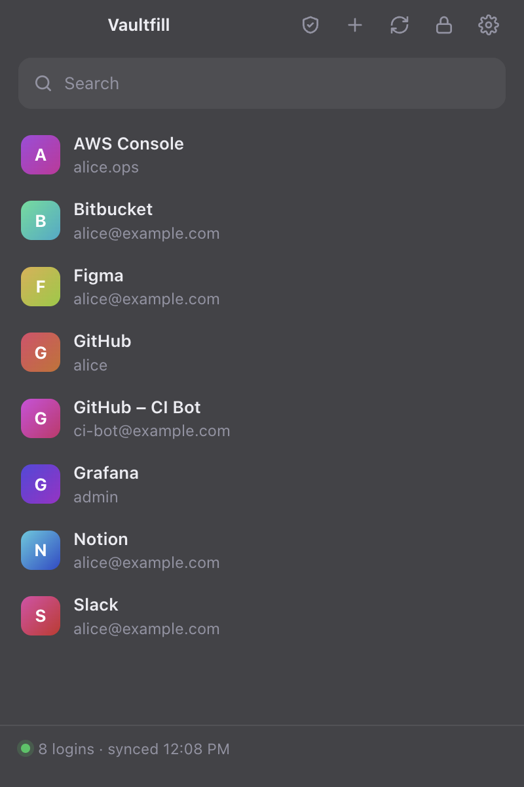
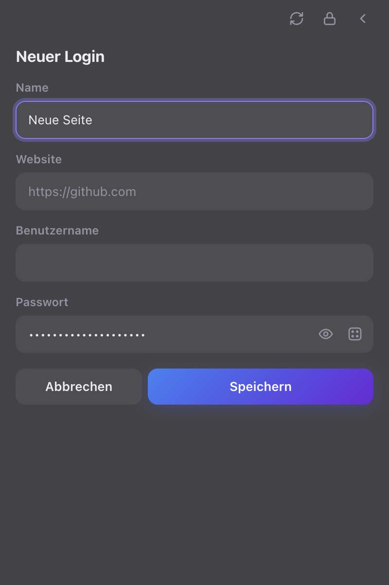
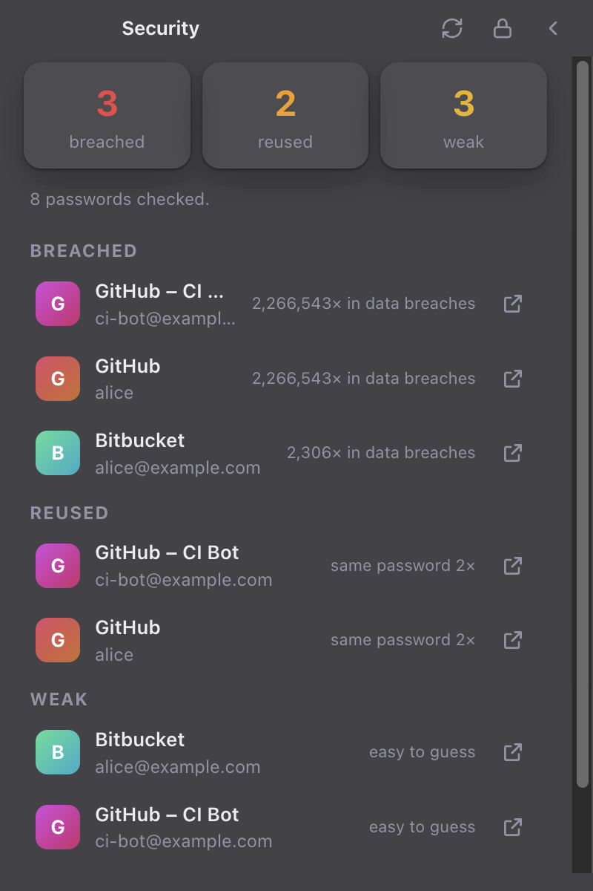
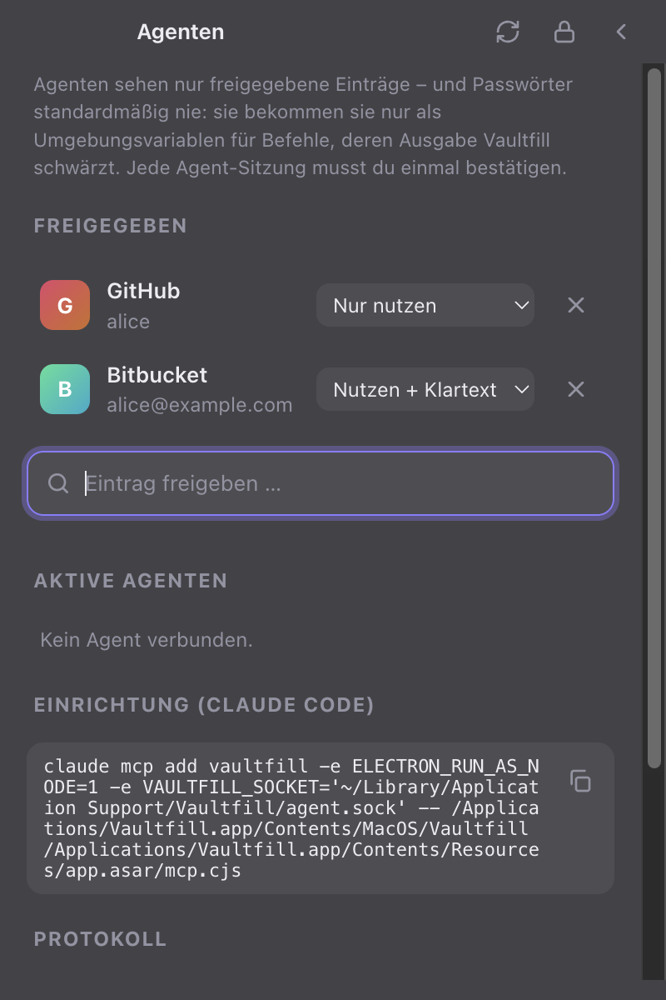
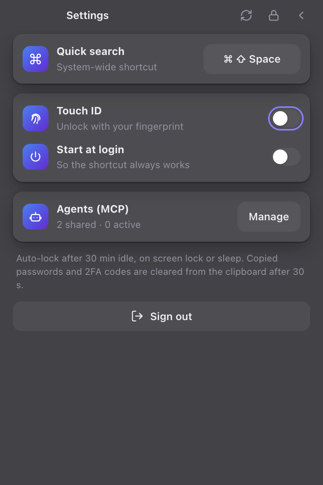
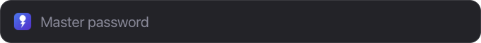

<div align="center">


# Vaultfill Desktop

**Your Vaultwarden – one shortcut away.**<br>
A macOS menu-bar app with Spotlight-style quick search that types your logins straight into any app.




<sub><b>⌘⇧Space</b> → type → <b>⏎</b>. Username ⇥ password land in the app that was in front.</sub>

</div>

---

## ✨ Features

| | |
|---|---|
| 🔎 **Quick search** | System-wide shortcut (configurable), searches all logins, most recently used first. |
| ⌨️ **Type into any app** | `⏎` types username ⇥ password, `⇧⏎` the password only. |
| 📋 **Copy** | `⌘C` username · `⌘⇧C` password (cleared from the clipboard after 30 s) · `⌘⌥C` 2FA code. |
| ➕ **New logins** | Straight from the search (`⌘N`) or in the main window – with a password generator. |
| 🛡️ **Password check** | Breached (Have I Been Pwned, k-anonymity), reused, weak. |
| 🤖 **Agents (MCP)** | Share test credentials with AI agents – without them ever seeing the passwords. |
| 👆 **Touch ID** | Unlock with your fingerprint; auto-lock after 30 min idle, on screen lock or sleep. |
| 🔐 **SSO & 2FA** | Vaultwarden with SSO (e.g. Entra ID) in its own sign-in window, TOTP or e-mail 2FA. |
| 🔄 **Live sync** | Changes from the browser extension and other clients arrive within seconds. |

> macOS only for now – see [#1](https://github.com/deeaitsch84/vaultfill-desktop/issues/1) for Windows. The user interface is currently in German.

## 📸 Screenshots

<table>
  <tr>
    <td align="center" width="33%"><br><sub><b>All logins</b></sub></td>
    <td align="center" width="33%"><br><sub><b>New login</b> with generator</sub></td>
    <td align="center" width="33%"><br><sub><b>Password check</b></sub></td>
  </tr>
  <tr>
    <td align="center"><br><sub><b>Agent shares</b> (MCP)</sub></td>
    <td align="center"><br><sub><b>Settings</b></sub></td>
    <td align="center" valign="middle"><br><sub><b>Locked?</b> Touch ID starts right away</sub></td>
  </tr>
</table>

## 🚀 Installation

**Download:** the signed and notarized app is attached to each [release](https://github.com/deeaitsch84/vaultfill-desktop/releases) – unzip, move `Vaultfill.app` to `/Applications`, start it, sign in. The icon lives in the menu bar.

- **First autotype:** macOS asks for **Accessibility** (and once for "control System Events") for Vaultfill.
- **Always available:** Settings → *Beim Anmelden starten* (start at login).

### Build it yourself

```bash
npm install
npm start           # development
npm run pack        # → dist/Vaultfill-darwin-arm64/Vaultfill.app (ad-hoc signed)
```

With a **Developer ID Application** certificate:

```bash
# once: store notarization credentials in the keychain (app-specific password)
xcrun notarytool store-credentials vaultfill-notary --apple-id <apple-id> --team-id <TEAMID>

VF_SIGN_IDENTITY="Developer ID Application: <Name> (<TEAMID>)" VF_NOTARY_PROFILE=vaultfill-notary npm run pack
# → dist/Vaultfill-darwin-arm64.zip (hardened runtime, notarized, ticket stapled)
```

Signing happens *after* the Electron fuses are set; entitlements are in `build/entitlements.plist` (JIT, Apple Events for autotype).

### Releases via GitHub Actions

Push a tag → [`release.yml`](.github/workflows/release.yml) builds on macOS, runs the tests, signs, notarizes and attaches `Vaultfill-vX.Y.Z-macos-arm64.zip` + `SHA256SUMS.txt` to a GitHub release:

```bash
git tag v0.2.0 && git push origin v0.2.0
```

The required repository secrets are listed at the top of the workflow file (certificate as `.p12`, App Store Connect API key for notarization).

## ⌨️ Shortcuts

| Where | Key | Action |
|---|---|---|
| Anywhere | `⌘⇧Space` | Open/close the quick search |
| Quick search | `⏎` · `⇧⏎` | Type username ⇥ password · password only |
| Quick search | `⌘C` · `⌘⇧C` · `⌘⌥C` | Copy username · password · 2FA code |
| Quick search | `⌘N` | Save the search term as a new login |
| App | `⌘,` | Settings |

## 🤖 Agent access via MCP

Let AI agents (e.g. Claude Code) run automated tests with real test accounts – **without passwords ending up in the agent's context.**


1. **Settings → Agenten (MCP) → Verwalten:** share entries – *for commands* or *for commands + plaintext*. Requires Node.js (the MCP server runs with the system Node).
2. Copy the `claude mcp add vaultfill …` command shown there and run it in a terminal.

| Tool | Returns |
|---|---|
| `list_shared_logins` | Name, username, URL, references (`vaultfill://<id>/password`) – **never passwords** |
| `run_with_secrets` | Runs a command with secrets as environment variables – only after you confirm it (the command is shown; optionally for the whole session). Runs with the agent's permissions, not Vaultfill's. Output is redacted (raw, URL-encoded, base64) |
| `reveal_secret` | Plaintext – only for *commands + plaintext* shares, **every call confirmed with Touch ID** |

- Every agent session needs your approval once; it ends with the agent or when Vaultfill locks. No stored token.
- A log of all access and a "disconnect" button in the app.
- ⚠️ Limit: if a command deliberately prints a secret in transformed form (reversed, split), redaction does not catch it. This protects against accidents, not against a malicious agent → **share test accounts only.**

## 🛡️ Security model

- **End-to-end like Bitwarden:** PBKDF2 / Argon2id, AES-CBC + HMAC – all local.
- **Data at rest** (encrypted vault, tokens, settings) is additionally sealed with `safeStorage` (key in the macOS keychain).
- **The decrypted key lives only in memory**; auto-lock on idle, screen lock and sleep.
- **Touch ID** releases a keychain-protected copy of the user key (same model as Bitwarden Desktop).
- **Autotype** goes through `osascript` via stdin – the password never shows up in the process list.
- **Breach check:** only the first 5 characters of the SHA-1 hash leave the Mac.
- **Hardened package:** Electron fuses off (`RunAsNode`, `NODE_OPTIONS`, `--inspect`), `app.asar` integrity validation on, bundle sealed – no other program can run code as Vaultfill to reach its keychain key.
- **Agents:** commands run in the MCP process with the agent's permissions (not with Vaultfill's Accessibility permission), every command that receives secrets is shown and confirmed, agent-supplied text is sanitized in dialogs, pairing has a cooldown after a denial.
- **Server:** plain http only for local servers; weak or suddenly weakened KDF settings are rejected. URL matching uses the Public Suffix List.

### Known limits

- Ad-hoc signature (default local build): after every rebuild macOS asks once for keychain access ("Always Allow"). With a Developer ID this goes away, and Gatekeeper accepts the app on other Macs.
- Touch ID releases a keychain-protected copy of the key; a native, biometry-bound keychain item would be stricter.
- A shared password can be printed in transformed form by a command you confirm – share test accounts only.

## 🧩 Architecture

| File | Role |
|---|---|
| `main.js` | Main process: state, login/SSO, unlock, sync, quick search, autotype, password check, agent socket |
| `vault.js` | Bitwarden protocol (identical to the extension's) |
| `mcp.cjs` | MCP server (stdio) – thin proxy, runs confirmed commands |
| `preload.cjs` | Narrow bridge `window.vf` for the UI |
| `ui/` | Main window, quick search, styles, icons |

## 🧪 Tests

```bash
npm test   # unit: URI matching, Public Suffix List, KDF checks, PIN, TOTP (RFC 6238), password strength
```

- **End-to-end** against a real Vaultwarden, cross-checked with the **official `bw` CLI** (registration, creating entries, password update incl. history) – see [`test/vault.test.mjs`](test/vault.test.mjs).
- **App smoke test** drives the real app (login, create, search, lock, password check, MCP flow incl. security cases) and produces the screenshots above – see [`test/smoke.js`](test/smoke.js).

## 🌐 Browser

Inline autofill, save after login and 2FA in the browser: **[vaultfill-extension](https://github.com/deeaitsch84/vaultfill-extension)**.

## 📄 License

[GPL-3.0](LICENSE) – free to use, modify and share; published derivatives must make their source code available too.
Bundled third-party components keep their licenses: [hash-wasm](lib/hash-wasm.LICENSE) (MIT), [Public Suffix List](lib/psl.LICENSE) (MPL-2.0).
Please report security issues privately – see [SECURITY.md](SECURITY.md).

---

<sub>Unofficial client. Bitwarden is a trademark of Bitwarden Inc.; Vaultfill is not affiliated with it.</sub>
