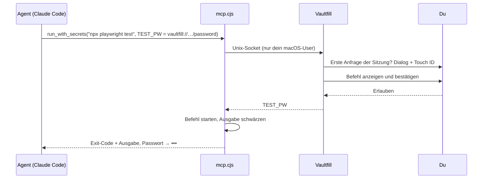

<div align="center">


# Vaultfill Desktop

**Dein Vaultwarden – eine Tastenkombination entfernt.**<br>
Menüleisten-App für macOS mit Spotlight-artiger Schnellsuche, die Logins direkt in jede App tippt.


<sub><b>⌘⇧Leertaste</b> → tippen → <b>⏎</b>. Benutzername ⇥ Passwort landen in der App, die gerade vorne war.</sub>

</div>

---

## ✨ Was es kann

| | |
|---|---|
| 🔎 **Schnellsuche** | Systemweites Kürzel (frei belegbar), Suche über alle Logins, zuletzt benutzte zuerst. |
| ⌨️ **In jede App tippen** | `⏎` tippt Benutzername ⇥ Passwort, `⇧⏎` nur das Passwort. |
| 📋 **Kopieren** | `⌘C` Benutzer · `⌘⇧C` Passwort (nach 30 s aus der Zwischenablage gelöscht) · `⌘⌥C` 2FA-Code. |
| ➕ **Neue Logins** | Direkt aus der Suche (`⌘N`) oder im Hauptfenster – mit Passwort-Generator. |
| 🛡️ **Passwort-Check** | Geleakt (Have I Been Pwned, k-Anonymität), mehrfach verwendet, schwach. |
| 🤖 **Agenten (MCP)** | Test-Zugangsdaten für KI-Agenten freigeben – ohne dass sie Passwörter zu sehen bekommen. |
| 👆 **Touch ID** | Entsperren per Fingerabdruck; Auto-Sperre nach 30 min Leerlauf oder Bildschirmsperre. |
| 🔐 **SSO & 2FA** | Vaultwarden mit SSO (z. B. Entra ID) im eigenen Anmeldefenster, TOTP- oder E-Mail-2FA. |
| 🔄 **Live-Sync** | Änderungen aus Browser-Extension & Co. kommen in Sekunden an. |

## 📸 Screenshots

<table>
  <tr>
    <td align="center" width="33%"><br><sub><b>Alle Logins</b></sub></td>
    <td align="center" width="33%"><br><sub><b>Neuer Login</b> mit Generator</sub></td>
    <td align="center" width="33%"><br><sub><b>Passwort-Check</b></sub></td>
  </tr>
  <tr>
    <td align="center"><br><sub><b>Agenten-Freigaben</b> (MCP)</sub></td>
    <td align="center"><br><sub><b>Einstellungen</b></sub></td>
    <td align="center" valign="middle"><br><sub><b>Gesperrt?</b> Touch ID startet sofort</sub></td>
  </tr>
</table>

## 🚀 Installation

```bash
npm install
npm run pack        # → dist/Vaultfill-darwin-arm64/Vaultfill.app
```

`Vaultfill.app` nach `/Applications` ziehen, starten, anmelden. Das Icon sitzt in der Menüleiste.

### Signiert & notarisiert (zum Weitergeben)

Ohne Variablen wird ad-hoc signiert (lokale Nutzung). Mit einem **Developer ID Application**-Zertifikat:

```bash
# einmalig: Zugangsdaten für die Notarisierung im Schlüsselbund ablegen (App-spezifisches Passwort)
xcrun notarytool store-credentials vaultfill-notary --apple-id <apple-id> --team-id <TEAMID>

VF_SIGN_IDENTITY="Developer ID Application: <Name> (<TEAMID>)" VF_NOTARY_PROFILE=vaultfill-notary npm run pack
# → dist/Vaultfill-darwin-arm64.zip (Hardened Runtime, notarisiert, Ticket geheftet)
```

Signiert wird *nach* dem Setzen der Electron-Fuses; Berechtigungen in `build/entitlements.plist` (JIT, Apple Events fürs Tippen).

### Release per GitHub Actions

Tag pushen → [`release.yml`](.github/workflows/release.yml) baut auf macOS, testet, signiert, notarisiert und hängt `Vaultfill-vX.Y.Z-macos-arm64.zip` + `SHA256SUMS.txt` an ein GitHub-Release:

```bash
git tag v0.2.0 && git push origin v0.2.0
```

Benötigte Repository-Secrets stehen im Kopf der Workflow-Datei (Zertifikat als `.p12`, App-Store-Connect-API-Key für die Notarisierung).

- **Erstes Tippen:** macOS fragt nach **Bedienungshilfen** (und einmalig „System Events steuern“) für Vaultfill.
- **Immer verfügbar:** Einstellungen → *Beim Anmelden starten*.
- Entwicklung: `npm start`.

## ⌨️ Kürzel

| Wo | Taste | Aktion |
|---|---|---|
| überall | `⌘⇧Leertaste` | Schnellsuche öffnen/schließen |
| Schnellsuche | `⏎` · `⇧⏎` | Benutzername ⇥ Passwort tippen · nur Passwort |
| Schnellsuche | `⌘C` · `⌘⇧C` · `⌘⌥C` | Benutzer · Passwort · 2FA-Code kopieren |
| Schnellsuche | `⌘N` | Suchbegriff als neuen Login speichern |
| App | `⌘,` | Einstellungen |

## 🤖 Agenten-Zugriff per MCP

Lass KI-Agenten (z. B. Claude Code) automatisierte Tests mit echten Test-Accounts fahren – **ohne dass Passwörter im Agenten-Kontext landen.**



1. **Einstellungen → Agenten (MCP) → Verwalten:** Einträge freigeben – *Für Befehle* oder *Für Befehle + Klartext*. Voraussetzung: Node.js (der MCP-Server läuft mit dem System-Node).
2. Den angezeigten `claude mcp add vaultfill …`-Befehl kopieren und im Terminal ausführen.

| Tool | Liefert |
|---|---|
| `list_shared_logins` | Name, Benutzername, URL, Referenzen (`vaultfill://<id>/password`) – **nie Passwörter** |
| `run_with_secrets` | Führt einen Befehl mit Secrets als Umgebungsvariablen aus – erst nach deiner Bestätigung (Befehl wird angezeigt, optional für die Sitzung). Läuft mit den Rechten des Agenten, nicht mit Vaultfills. Ausgabe geschwärzt (roh, URL-kodiert, Base64) |
| `reveal_secret` | Klartext – nur bei *Für Befehle + Klartext*, **jeder Abruf per Touch ID** bestätigt |

- Jede Agent-Sitzung braucht einmal deine Bestätigung; sie endet mit dem Agenten oder beim Sperren. Kein gespeichertes Token.
- Protokoll aller Zugriffe und „Trennen“ in der App.
- ⚠️ Grenze: Gibt ein Befehl ein Secret absichtlich verfremdet aus (rückwärts, zerstückelt), greift die Schwärzung nicht. Schutz vor Versehen, nicht vor einem bösartigen Agenten → **nur Test-Accounts freigeben.**

## 🛡️ Sicherheitsmodell

- **Ende-zu-Ende wie Bitwarden:** PBKDF2 / Argon2id, AES-CBC + HMAC – alles lokal.
- **Ruhender Zustand** (verschlüsselter Vault, Tokens, Einstellungen) zusätzlich per `safeStorage` versiegelt (Schlüssel im macOS-Schlüsselbund).
- **Entschlüsselter Schlüssel nur im Speicher**; Auto-Sperre bei Leerlauf/Bildschirmsperre.
- **Touch ID** gibt eine Schlüsselbund-geschützte Kopie des User-Keys frei (gleiches Modell wie Bitwarden Desktop).
- **Tippen** über `osascript` per stdin – das Passwort erscheint nie in der Prozessliste.
- **Leak-Check:** nur die ersten 5 Zeichen des SHA-1-Hashes verlassen den Mac.
- **Gehärtetes Paket:** Electron-Fuses aus (`RunAsNode`, `NODE_OPTIONS`, `--inspect`), `app.asar`-Integritätsprüfung an, Bundle versiegelt – kein anderes Programm kann als Vaultfill Code ausführen und so an den Schlüsselbund-Schlüssel kommen.
- **Agenten:** Befehle laufen im MCP-Prozess mit den Rechten des Agenten (nicht mit Vaultfills Bedienungshilfen-Recht), jeder Befehl mit Secrets wird angezeigt und bestätigt, Agent-Angaben im Dialog bereinigt, Kopplung mit Abklingzeit nach Ablehnung.
- **Server:** http nur für lokale Server; zu schwache oder plötzlich abgeschwächte KDF-Einstellungen werden abgelehnt. URL-Abgleich nach der Public Suffix List.

### Bekannte Grenzen

- Ad-hoc-Signatur (Standard-Build): Nach jedem Neubau fragt macOS einmal nach dem Schlüsselbund-Zugriff („Immer erlauben“). Mit Developer ID entfällt das, und Gatekeeper akzeptiert die App auf anderen Macs.
- Touch ID gibt eine Schlüsselbund-geschützte Kopie des Schlüssels frei; eine native, biometrie-gebundene Keychain-Ablage wäre noch strenger.
- Ein freigegebenes Passwort kann ein Befehl, den du bestätigst, absichtlich verfremdet ausgeben – nur Test-Accounts freigeben.

## 🧩 Aufbau

| Datei | Aufgabe |
|---|---|
| `main.js` | Main-Prozess: Zustand, Login/SSO, Entsperren, Sync, Schnellsuche, Tippen, Passwort-Check, Agenten-Socket |
| `vault.js` | Bitwarden-Protokoll (identisch mit der Extension) |
| `mcp.cjs` | MCP-Server (stdio) – dünner Proxy ohne eigene Secrets |
| `preload.cjs` | Schmale Brücke `window.vf` für die Oberfläche |
| `ui/` | Hauptfenster, Schnellsuche, Styles, Icons |

## 🧪 Tests

```bash
npm test   # Unit: URI-Matching, PIN, TOTP (RFC 6238), Passwortstärke
```

- **E2E** gegen ein echtes Vaultwarden, gegengeprüft mit der **offiziellen `bw` CLI** (Registrierung, Anlegen, Passwort-Update inkl. Historie) – siehe [`test/vault.test.mjs`](test/vault.test.mjs).
- **App-Smoke-Test** fährt die echte App (Login, Anlegen, Suche, Sperren, Passwort-Check, MCP-Durchlauf) und erzeugt die Screenshots oben – siehe [`test/smoke.js`](test/smoke.js).

## 🌐 Browser

Inline-Autofill, Speichern nach dem Login und 2FA im Browser: **[vaultfill-extension](https://github.com/deeaitsch84/vaultfill-extension)**.

## 📄 Lizenz

[GPL-3.0](LICENSE) – frei nutzbar, veränderbar und weitergebbar; veröffentlichte Ableger müssen ihren Quellcode ebenfalls offenlegen.
Mitgelieferte Drittkomponenten behalten ihre Lizenz: [hash-wasm](lib/hash-wasm.LICENSE) (MIT), [Public Suffix List](lib/psl.LICENSE) (MPL-2.0).
Sicherheitslücken bitte privat melden – siehe [SECURITY.md](SECURITY.md).

---

<sub>Inoffizieller Client. Bitwarden ist eine Marke der Bitwarden Inc.; Vaultfill ist damit nicht verbunden.</sub>
